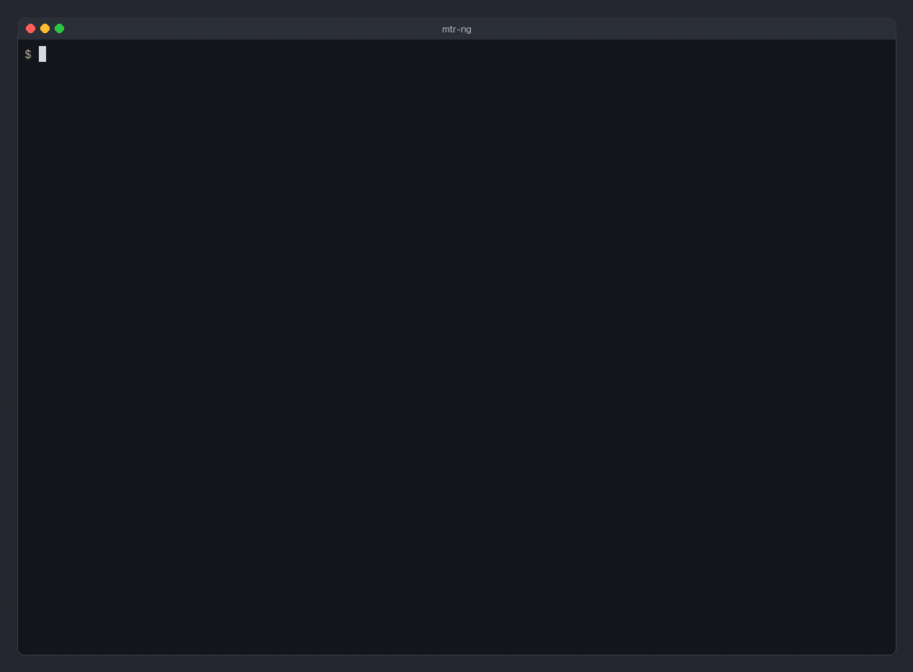

# MTR-NG - Modern My Traceroute in Rust

mtr-ng is My Traceroute (mtr) reimplemented in Rust. It probes every hop on the path to a host, round after round, and shows how each hop's loss, round-trip times and jitter change, in a terminal interface or as a report.



The recording is a live trace from a home network, and `--privacy-hops 3` hides its first three hops. It is also available as an [MP4](docs/demo.mp4).

## Features

### Core Network Analysis
- **Path tracing**: every round sends one probe to each hop, and the table changes as the replies arrive. A round starts every second, and `-i` sets another interval in milliseconds
- **RTT statistics**: each hop keeps its last, best, worst and average RTT, their standard deviation, and an exponential moving average, which `--ema-alpha` makes follow new RTTs faster or slower
- **Packet loss**: a probe without an answer after 2 seconds counts as lost, and probes still in flight stay out of the loss until then
- **Jitter**: `jitter` is how much a hop's last two RTTs differ, and `jitter-avg` the mean of all those differences

### Visualization
- **Sparklines**: the graph column draws a hop's recent replies as bars (`▁▂▂▆█▄▂▃▂▁`), newest on the right, and `v` turns them into a heatmap of colour alone
- **Colour**: colour, like bar height, places each reply between the fastest and the slowest reply of all hops, from blue to orange in true colour. A lost probe is a red `·`
- **Columns**: `--fields` and the column chooser decide which columns show, and in what order (see below)
- **Scale**: the scale stretches to fit the replies to the latest 100 probes of every hop. It is logarithmic unless `--sparkline-scale linear` says otherwise, and `s` switches between the two while mtr-ng runs

### Load Balancers and MPLS
- **Stable flows**: `--flows N` probes N flows in turn. All probes of one flow carry the same ICMP checksum and identifier (Paris traceroute), so a per-flow load balancer keeps each on one path, and the flows together show the paths it spreads traffic over. `-P udp` keeps the ports fixed per flow instead, and IPv6 probes carry a flow label per flow. Load balancers hash on ports far more often than on ICMP fields, so UDP flows show more diamonds
- **Every branch** (`--flows auto`): new flows, one per round, until each hop has answered enough of them to be 95% sure no load-balanced branch was missed (MDA-Lite: 6 flows rule out a second branch, 11 a third, 16 a fourth). After that only the fewest flows that together pass every address take turns, so each branch keeps its own loss and RTT, and every ten minutes the search starts over. A note under each balanced hop says how many branches it has, and the report ends with what was found and where branches cross, which can hide one
- **Flow matrix**: `f` shows, per hop, a letter for the address each flow met; `--report` prints the same matrix after the table
- **Route graph**: `--dot` prints the routes as Graphviz, with silent hops as dashed edges
- **MPLS labels and interfaces**: `-e` (or `e` while running) shows the label stacks routers report in ICMP extensions (RFC 4950), and the interface a probe came in on when a router names it (RFC 5837): its name, address, ifIndex and MTU, as in `[Interface in: et-0/0/2.100 203.0.113.6 ifIndex 531 MTU 9192]`. That address can differ from the one the reply comes from, and an unnumbered interface has no other. Few routers send it; Linux routers can, from late 2025, with `net.ipv4.icmp_errors_extension_mask=1`.
- **Path MTU**: `--pmtu` finds the largest packet that crosses the path and the hop where it narrows, from the Fragmentation Needed or Packet Too Big a router sends. When large probes vanish without such a message, a black hole for path MTU discovery, it finds the size by halving, and then the hop past which they vanish, by sending probes of that size to nearer hops
- **Probe size**: probes are 64 bytes with their IP header, as mtr's are, and `-s`/`--psize` sets another size from 28 to 1500. Some MPLS routers never answer probes much smaller than that, so their hops stay `???` with tiny probes. Zero padding leaves a flow's checksum as it was
- **Hop details**: `Enter` opens every responder of a hop with its share, RTTs, routers on the way back and flows, plus RTT percentiles and a histogram
- **Return path**: the Back column (`--fields hop,host,back,loss,avg`) counts the routers a reply crossed, from the TTL it arrived with. `9 +2` means two more than the probe crossed on the way there: the reply came back another way
- **NAT**: routers past a NAT quote the probe in their ICMP errors, and a NAT that doesn't translate those quotes back shows in them: the probe arrives from the NAT's address, or (IPv4 echo requests) with the checksum the NAT gave it. A note under the first hop past each such NAT says so, as in `NAT before this hop: probes reach it from 203.0.113.9`, and the hop details and JSON carry it. UDP probes past it are matched again by taking the NAT's change off their checksum, which is how mtr-ng tells them apart. Linux's NAT, in most home routers, translates the quotes back, so it can't be seen this way

### Where Is It
- **Locations**: `-g` adds a Location and a Dist column, from a local geolocation database (DB-IP City Lite or MaxMind GeoLite2 City). Lookups never leave the machine; private addresses are never looked up
- **Light-speed check**: a reply can't come from farther than light in fibre travels in its round trip, about 100 km per ms. A location the hop's best RTT rules out is marked `!`, which catches routers placed at their owner's head office and anycast addresses placed at their registrant's
- **Router names**: backbones name routers after their city, in codes of their own (`adm-b3-link.ip.twelve99.net` is Arelion in Amsterdam). For Arelion, Cogent, Hurricane Electric, Lumen and Zayo that city goes before the database, which often places routers at a head office
- **Map**: `m` draws the located hops on a world map, joined along great circles; `+2` on an arc means it passes over two hops that aren't on the map. Locations the RTT rules out stay off it
- **GeoJSON**: `--geojson` writes the same as a file for map tools: a point per located hop with its statistics, and the path along great circles
- **Origin**: distances are measured from `--origin LAT,LON`, or else from the first hop placed in a city

### Column Selection System
- **Fields**: `--fields` takes any of 21 columns, in the order they should appear:
  - `hop`, `host`, `asn`, `as-name`, `prefix`, `geo`, `dist`, `stretch`, `reach`, `back`
  - `loss`, `sent`, `last`, `avg`, `ema`, `jitter`, `jitter-avg`, `best`, `worst`, `stdev`, `graph`
- **All columns**: `--show-all` shows every column
- **Interactive chooser**: `o` opens a column chooser to show, hide and reorder columns
- **Reports**: the columns chosen with `--fields` apply to `--report` as well

### Interface Modes
- **Terminal interface**: by default the table updates as replies arrive, and keys switch between the table, the flow matrix, the route graph and the map (see Interactive Mode)
- **Report mode**: `-r` runs 10 rounds, or as many as `-c` says, and then prints a table for people or JSON, CSV, Graphviz, Mermaid or GeoJSON for scripts
- **Prometheus exporter**: `--metrics PORT` serves per-hop loss and RTT for Prometheus to scrape, alongside the TUI or, with `-r`, until stopped
- **Colour depth**: mtr-ng reads it from `COLORTERM` and `TERM` (none, 16, 256 or true colour), and `c` cycles through them

### Platforms and Protocols
- **Platforms**: mtr-ng runs on macOS and Linux, on both without sudo for ICMP (see Privileges). Windows probes without administrator rights too, but has been tested only over loopback and has no release download yet; FreeBSD is only type-checked.
- **IPv4 and IPv6**: a name with both kinds of address is traced over IPv6 when this machine has an IPv6 route, as a connection would be, else over IPv4; `-4` and `-6` choose. Probes are ICMP echo requests by default, or UDP datagrams to port 33434 and up with `-P udp`; `-P tcp` exits with an error for now. Hop names come from reverse DNS, which `-n` turns off.

## Installation

Each [release](https://github.com/gedejong/mtr-ng/releases) from 0.4.0 on has binaries for macOS and Linux, x86_64 and ARM, with checksums. Up to 0.3.0 mtr-ng lived at `edejong-dbc/mtr-ng`, an account that can no longer be reached, so the old repository, tap and crate stay at 0.3.0.

#### Shell installer (macOS, Linux)
```bash
curl --proto '=https' --tlsv1.2 -LsSf https://github.com/gedejong/mtr-ng/releases/latest/download/mtr-ng-installer.sh | sh
```

#### Homebrew (macOS, Linux)
```bash
brew install gedejong/tap/mtr-ng
```
If you installed it from the old `edejong-dbc/tap`, run `brew uninstall mtr-ng && brew untap edejong-dbc/tap` first.

#### Debian/Ubuntu (amd64, arm64)
Download the `.deb` from the release, then:
```bash
sudo dpkg -i mtr-ng_*.deb
```

#### Cargo
The crate on crates.io is stuck at 0.3.0 for now, so install from GitHub:
```bash
cargo install --locked --git https://github.com/gedejong/mtr-ng
```

### From Source
```bash
git clone https://github.com/gedejong/mtr-ng
cd mtr-ng
cargo build --release --locked
sudo cp target/release/mtr-ng /usr/local/bin/
sudo cp install/mtr-ng.1 /usr/local/share/man/man1/
```

### Shell completions
Homebrew and the `.deb` install completions for bash, zsh and fish, and the release archives carry them (`mtr-ng.bash`, `_mtr-ng`, `mtr-ng.fish`). From a checkout or after `cargo install`, they are in `install/completions/`; for zsh, for example, copy `_mtr-ng` into a directory on your `$fpath`.

### Privileges
- **macOS**: runs as a normal user, through unprivileged ICMP sockets, without sudo.
- **Linux**: ICMP works as a normal user through a ping socket when the user's group is in `net.ipv4.ping_group_range`, which systemd 243 and newer open to everyone. Check with `sysctl net.ipv4.ping_group_range`: `0 2147483647` allows all groups, `1 0` none. Ping sockets don't pass on MPLS labels or interfaces. Otherwise, and for `-P udp`, mtr-ng needs raw sockets, so root or `CAP_NET_RAW`. Either run it with `sudo`, or grant the capability to the installed binary once:
  ```bash
  sudo setcap cap_net_raw+ep "$(readlink -f "$(which mtr-ng)")"
  # or, with checks and a test run:
  scripts/setup-capabilities.sh
  ```
  The capability is narrower than sudo (raw sockets only, not full root). Copying a new binary over the old one drops it, so set it again afterwards. The `.deb` sets it on install, when `setcap` (package `libcap2-bin`) is there.

  However it gets them, mtr-ng opens its raw sockets first and then gives the privileges up before it resolves the target or reads a packet, as mtr's `mtr-packet` does: a capability-holding user ends up with no capabilities, and root keeps only the right to read files.
- **FreeBSD**: has no unprivileged ICMP socket, so mtr-ng needs root: run it with `doas mtr-ng example.com` (from `security/doas`, with a rule in `/usr/local/etc/doas.conf` such as `permit :wheel cmd /usr/local/bin/mtr-ng`) or `sudo`. Or install it setuid root (`chown root:wheel` and `chmod u+s` on the binary): it opens its raw sockets and then becomes the user who ran it, before it does anything else. FreeBSD builds are type-checked in CI but have not been run yet.
- **Windows**: runs as a normal user. mtr-ng sends its echo requests through Windows' ICMP API, as `tracert` does, and that API builds the packets itself: on Windows there are no flows (`--flows`), UDP probes, MPLS labels or `--pmtu`. There is no release download yet; build it with `cargo build --release`.

mtr-ng never falls back to fake data: if it can't probe, it exits with an error. Use `--simulate` for a demo without network access.

## Usage Examples

### Basic Usage
```bash
# Standard trace with default columns
mtr-ng google.com

# Show all available metrics
mtr-ng google.com --show-all

# Custom column selection
mtr-ng google.com --fields hop,host,loss,last,avg,graph

# Focus on jitter analysis  
mtr-ng google.com --fields hop,host,jitter,jitter-avg,graph
```

### Interactive Mode
```bash
# Real-time monitoring with keyboard controls
mtr-ng google.com

# Keys (press ? for the full list, or see `man mtr-ng`):
# q / Ctrl-C  Quit
# o           Choose and order columns
# r           Reset statistics
# h           Host names or IP addresses
# s, v, c     RTT scale, sparkline/heatmap, colour mode
# f           Hop table or flow matrix
# m           Hop table or map
# g           Hop table or route graph (branches side by side)
# e           Show or hide MPLS labels and interfaces
# ↑ ↓ PgUp PgDn Home End  Select and scroll hops
# Enter       Details of the selected hop (↑ ↓ for the others)
# a           About: what leaves this machine, and the data credits
```

Colours follow `NO_COLOR` and `TERM=dumb`.

### Report Mode
```bash
# Generate report output
mtr-ng google.com --report

# Fewer columns
mtr-ng google.com --report --fields hop,host,loss,avg

# Machine-readable: JSON with mtr's field names, or CSV
mtr-ng google.com --json
mtr-ng google.com --csv > trace.csv

# The located hops and the path as GeoJSON, for geojson.io, QGIS or GitHub
mtr-ng -c 20 --geojson google.com > path.geojson

# AS numbers via Team Cymru's DNS (public addresses only); the detail pane
# (Enter) adds each AS's name and the prefix the router is in
mtr-ng -z google.com
mtr-ng -r --fields hop,host,asn,as-name,prefix,loss,avg google.com

# Follow 8 flows: the report ends with which address each flow met
mtr-ng -r -c 40 --flows 8 google.com

# Find every load-balanced branch, then follow one flow per branch
mtr-ng -r -P udp --flows auto google.com

# The routes as a picture, or as a Mermaid flowchart for a GitHub issue
mtr-ng -c 40 --flows 8 --dot google.com | dot -Tsvg > routes.svg
mtr-ng -c 40 --flows 8 --mermaid google.com

# MPLS labels and interfaces under their hop
mtr-ng -r -e google.com

# Where each hop is, and whether its RTT allows it
mtr-ng -r -g google.com
mtr-ng -r -g --origin 52.37,4.89 google.com

# Also ask RIPE IPmap, which places routers by measurement, and needs no database
mtr-ng -r --ipmap google.com

# A report to share: hops 1 and 2 are hidden and never looked up
mtr-ng -r --privacy-hops 2 google.com

# Keep a log of every probe, reply and lookup; play it back later, ten times as
# fast, or print its report (any format) at once
mtr-ng --record trace.ndjson google.com
mtr-ng --replay trace.ndjson --replay-speed 10
mtr-ng --replay trace.ndjson --json

# Trace until stopped, for Prometheus to scrape at http://127.0.0.1:9819/metrics;
# Ctrl-C prints the report
mtr-ng -r -n --metrics 9819 google.com
```

## Advanced Features

### Geolocation
`-g`, the `geo` and `dist` columns and the map need a database in MaxMind's format. mtr-ng uses `--geoip-mmdb PATH`, else the newest `.mmdb` in `~/.local/share/mtr-ng`, else `dbip-city-lite.mmdb` or `GeoLite2-City.mmdb` in `/usr/share/GeoIP`, `/var/lib/GeoIP` or Homebrew's `var/GeoIP`. DB-IP's free City Lite database (CC BY 4.0, about 130 MB) is updated monthly:
```bash
mkdir -p ~/.local/share/mtr-ng && \
curl -fL "https://download.db-ip.com/free/dbip-city-lite-$(date +%Y-%m).mmdb.gz" | \
gunzip > ~/.local/share/mtr-ng/dbip.part && \
mv ~/.local/share/mtr-ng/dbip.part ~/.local/share/mtr-ng/dbip-city-lite.mmdb
```
Both licences ask for credit wherever the data is shown, so the report, the map and the hop details name the database's source. The map's coastlines are Natural Earth's 1:50m set, which is in the public domain.

A database places a router where its owner registered it, often a head office a continent away, and anycast addresses wherever their registrant sits. mtr-ng therefore treats a location as a claim to test: a hop farther from the origin than its best RTT allows, granting both locations their accuracy, is marked `!`. Without `--origin` the origin is the first hop placed in a city, and the probing host is somewhere within that hop's reach, which widens the margin; with `--origin` the check is tighter. The check can only rule a location out: one without `!` is possible, not confirmed.

The `stretch` column turns the same arithmetic around: a hop's best RTT, less the origin hop's (so the local network and the access line don't count), over the round trip light in fibre needs for the distance. 1.0 would be a straight fibre; most paths take 2 or 3, and a hop well above its neighbours sits behind a detour. Hops nearer than 100 km get none, since there the routers' own delay is most of the RTT. The report also says how long the path through the located hops is against the great circle to the last of them, as does the map's key.

In `--json` each hub carries a `geo` object (city, country, lat, lon, accuracy_km, distance_km, impossible, from_name, from_ipmap), and `mtr.geo` says whose locations they are and where distances are measured from. `--geojson` is RFC 7946: coordinates are [longitude, latitude], ruled-out hops are points with `"impossible": true` (red in viewers that read simplestyle-spec) and stay off the path, and a path across the date line is cut there.

Router names are often better evidence. Large networks name their routers after the city they stand in, each in codes of its own: Arelion's `adm` is Amsterdam, `win` Vienna and `san` San Antonio, while to Cogent, which uses airport codes, `san` is San Diego. mtr-ng carries the codes of Arelion, Cogent, Hurricane Electric and Lumen, taken from the router lists in their looking glasses (and, for Cogent's other sites, OurAirports' list of large airports). Zayo's looking glass lists no codes, but its names give an airport and a country, as `ae7.cr1.ord8.us.zip.zayo.com` does for Chicago O'Hare, so mtr-ng reads them as large airports and takes one only when it is in that country. When a hop's name has one, that city goes before the database, unless the RTT rules it out and not the database's location; the hop details say `adm in its name`. The names come from reverse DNS, so `-n` turns this off.

`--ipmap` also asks [RIPE IPmap](https://ipmap.ripe.net) where each public address that answers is. IPmap places routers by measuring them from nearby RIPE Atlas probes, which a database can't, and gives each answer a score: those resting on measurements scored 38 to 57 in testing, those resting only on reverse DNS, crowdsourcing or a city's population 30 or less, and those were wrong about as often as right. mtr-ng takes city-level answers that score 30 or more, and none for anycast addresses, which have no one place. Such an answer replaces the database's location, but not a city from the router's name, and not when the RTT rules it out and not the database's location. The hop details say `RIPE IPmap, score 51`, and the credits name IPmap wherever its locations are shown. `--ipmap` works without a database too. It sends the addresses to the RIPE NCC (see Privacy), so it is off unless asked for.

### Privacy
Apart from the probes themselves, mtr-ng sends only names and addresses. The target's name and, unless `-n`, the name of every address that answers go to this machine's resolver; with `-z`, every public address that answers goes to Team Cymru's DNS service. Locations are looked up in a local database, and with `--ipmap` every public address that answers also goes to RIPE IPmap, which may measure it from RIPE Atlas probes. Private addresses are never looked up anywhere. With `--metrics`, anyone who can reach its address can read the trace. `a` in the TUI lists this for the running trace, with the data sources and their licences.

`--privacy-hops N` hides the first N hops, usually your own network and your provider's first routers, in the TUI and in every report format: their addresses, names, ASes and locations show as `(hidden)` or not at all, the local host name in the report header too, and they are never looked up. Load-balanced branches among them stay apart, as `A (hidden)` and `B (hidden)` in the flow matrix.

### Prometheus
`--metrics [ADDR:]PORT` serves the trace at `http://ADDR:PORT/metrics` for as long as it runs, as OpenMetrics to scrapers that ask for it, Prometheus among them, and in the older Prometheus text format to the rest. A bare port listens on 127.0.0.1; `0.0.0.0:9819` or `[::]:9819` opens it to the network, and with it the trace. With `-r` and no `-c` mtr-ng runs until Ctrl-C or SIGTERM and then prints the report, which suits a systemd service; without `-r` the TUI runs as usual and serves alongside. Hops hidden by `--privacy-hops` stay hidden here.

| Metric | Type | Labels besides `target` |
|---|---|---|
| `mtr_ng_trace_info` | info | `target_addr`, `protocol`, `version` |
| `mtr_ng_rounds_total` | counter | |
| `mtr_ng_path_hops`, `mtr_ng_target_reached` | gauge | |
| `mtr_ng_path_mtu_bytes` | gauge, with `--pmtu` | |
| `mtr_ng_hop_sent_total`, `_received_total`, `_lost_total` | counter | `hop` |
| `mtr_ng_hop_loss_ratio` | gauge, in-flight probes left out | `hop` |
| `mtr_ng_hop_rtt_seconds` | summary: quantiles 0.5, 0.9 and 0.99 over the last 600 probes, sum and count over all | `hop` |
| `mtr_ng_hop_last_rtt_seconds`, `_best_`, `_worst_`, `mtr_ng_hop_rtt_stddev_seconds`, `mtr_ng_hop_jitter_seconds` | gauge | `hop` |
| `mtr_ng_hop_responder_info` | info | `hop`, `addr`, and `host`, `asn`, `prefix`, `as_name` when known |
| `mtr_ng_hop_responder_replies_total` | counter | `hop`, `addr` |

Counters let Prometheus work out any window: the loss at hop 5 over the last five minutes is `rate(mtr_ng_hop_lost_total{hop="5"}[5m]) / (rate(mtr_ng_hop_lost_total{hop="5"}[5m]) + rate(mtr_ng_hop_received_total{hop="5"}[5m]))`, and its mean RTT `rate(mtr_ng_hop_rtt_seconds_sum[5m]) / rate(mtr_ng_hop_rtt_seconds_count[5m])`. A route change shows as a new address in `mtr_ng_hop_responder_replies_total`.

### Record and replay
`--record PATH` writes what the trace sees as it happens, one JSON object per line: what was traced, from where and how, then each probe sent, each reply (from whom, its RTT, TTL and MPLS labels) or timeout, and each name and AS that arrived, stamped with the seconds since the start.
```json
{"t":0.0,"event":"start","version":"0.6.2","start":"2026-10-29T21:40:49Z","source":"laptop","target":"1.1.1.1","target_addr":"1.1.1.1","protocol":"icmp","flows":"1","interval_ms":1000,"max_hops":30,"simulated":false}
{"t":1.005632,"event":"sent","hop":1,"flow":0,"probe":1}
{"t":1.011853,"event":"reply","hop":1,"probe":1,"from":"192.168.1.1","kind":"time_exceeded","rtt_ms":6.221,"reply_ttl":64}
{"t":1.0302,"event":"name","addr":"198.51.100.1","name":"core-1.isp.example"}
```
`--replay PATH` plays a log back without sending a probe or a lookup: in the TUI at the pace it was recorded, or `--replay-speed` times faster, and with `-r` (or `--json`, `--csv`, `--dot`, `--mermaid`, `--geojson`) as a report printed at once. The replay rebuilds the same statistics, since it gives the session the same events; only the path MTU search and the branch search of `--flows auto` are not recorded, so their notes are missing. PATH must not exist when recording, so a log is never overwritten. Hops hidden by `--privacy-hops` are recorded hidden. An hour at one round a second takes about 10 MB.

### Simulation Mode
`--simulate` answers probes from a made-up path instead of the network, through the same probing loop as real probes, and marks the screen SIMULATED. The path has a load-balanced pair of routers inside an MPLS tunnel, a router that never answers, some loss and the odd latency spike. Its addresses come from the documentation ranges and its names end in `.example`. It comes with made-up locations, including one the light-speed check rules out, so `-g` and the map work without a database.
```bash
# No network, no privileges
mtr-ng --simulate example.com

# The load balancer shows up with two flows or more
mtr-ng --simulate -r -c 8 --flows 4 -e example.com

# Two balanced hops, found with 16 flows, followed with 3
mtr-ng --simulate -r --flows auto example.com
```

### Sparklines
The graph column gives each probe one cell, newest on the right, with a bar of eight heights (`▁▂▃▄▅▆▇█`). Bar height and colour place each reply on one RTT scale that all hops share, drawn and labelled under the table; `·` is a lost probe and `?` one still in flight. A cell appears when its probe is sent and changes when the reply arrives.

### Jitter
A hop's jitter is how much its RTT changed from one reply to the next: `jitter` shows the latest change and `jitter-avg` the mean of all of them. Jitter that starts at one hop and carries on to every hop after it points at a link that queues; jitter at one hop alone usually means that router is slow to answer, which says nothing about the traffic it forwards.

## Column Reference

| Column      | Description                    | Example  |
|-------------|--------------------------------|----------|
| `hop`       | Hop number                     | `1`      |
| `host`      | Hostname/IP address            | `gateway.local` |
| `asn`       | Origin AS (with `-z`)          | `AS13335` |
| `as-name`   | The AS's handle                | `CLOUDFLARENET` |
| `prefix`    | Announced prefix               | `1.1.1.0/24` |
| `geo`       | Location (with `-g`)           | `Amsterdam, NL` |
| `dist`      | Distance from the origin, km   | `357`    |
| `stretch`   | RTT over light in fibre's for that distance | `2.8` |
| `reach`     | Farthest the best RTT reaches, km | `1071` |
| `back`      | Routers on the way back        | `6 +1`   |
| `loss`      | Packet loss percentage         | `2.0%`   |
| `sent`      | Packets sent                   | `10`     |
| `last`      | Most recent RTT               | `15.2ms` |
| `avg`       | Average RTT                   | `18.4ms` |
| `ema`       | Exponential moving average    | `17.8ms` |
| `jitter`    | Last jitter value             | `2.1ms`  |
| `jitter-avg`| Average jitter                | `1.8ms`  |
| `best`      | Minimum RTT observed          | `12.1ms` |
| `worst`     | Maximum RTT observed          | `45.2ms` |
| `stdev`     | RTT standard deviation        | `3.1ms`  |
| `graph`     | RTT sparkline visualization   | `▁▂▄▇▆▃▁` |

## Development & Testing

### Testing Without Sudo
None of these commands needs administrator rights:

```bash
# Quick start - test simulation mode
cargo run -- --simulate --count 3 --report google.com

# Run all unit tests
cargo test

# The CI gate: fmt, clippy, tests
just ci

# Real probes over loopback (no sudo on macOS, nor on Linux where ping sockets are allowed)
cargo build && ./target/debug/mtr-ng -r -c 2 -n 127.0.0.1
```

**Testing Documentation**: See [TESTING.md](TESTING.md) for simulation, the headless TUI check, recorded traces and the Linux network lab, and [DEVELOPMENT.md](DEVELOPMENT.md) for how probing works and how CI is set up.

### Development Tools
The `justfile` holds the commands used while developing, and `just --list` shows them. `--simulate` exercises the TUI and the statistics without network access, and `cargo test` runs the unit tests.

## Contributing

Contributions are welcome, for example in these areas:
- Terminal graphics and visualization
- TCP probes
- More statistics
- Platform-specific work

**Getting started**: simulation mode lets you develop without sudo, as [TESTING.md](TESTING.md) explains.

## License

Licensed under either of

- Apache License, Version 2.0 ([LICENSE-APACHE](LICENSE-APACHE) or <https://www.apache.org/licenses/LICENSE-2.0>)
- MIT license ([LICENSE-MIT](LICENSE-MIT) or <https://opensource.org/licenses/MIT>)

at your option.

Unless you explicitly state otherwise, any contribution intentionally submitted for inclusion in the work by you, as defined in the Apache-2.0 license, shall be dual licensed as above, without any additional terms or conditions.
